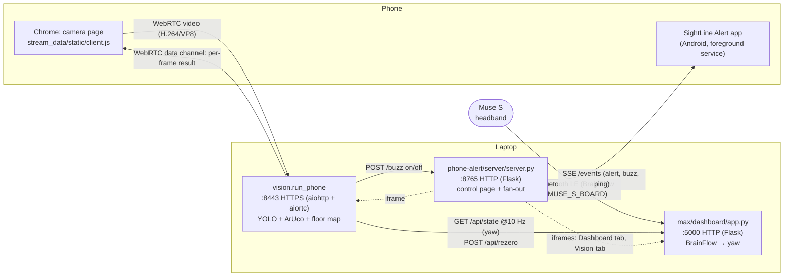
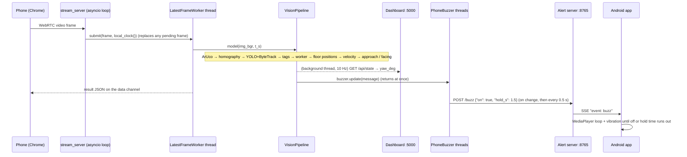

# SightLine architecture

How SightLine works end to end: every process, the tech it uses, how data moves between the parts, and which files to read. It's detailed enough to rebuild the system from. For *running* it, see [RUNNING.md](RUNNING.md); for setup, see [SETUP.md](SETUP.md).

**Contents**

1. [What the system does](#1-what-the-system-does)
2. [The system at a glance](#2-the-system-at-a-glance)
3. [Tech stack](#3-tech-stack)
4. [Shared conventions](#4-shared-conventions)
5. [One frame, end to end](#5-one-frame-end-to-end)
6. [Component deep dives](#6-component-deep-dives)
   - [6.1 Phone camera stream (`stream_data/`)](#61-phone-camera-stream-stream_data)
   - [6.2 Vision pipeline (`vision/`)](#62-vision-pipeline-vision)
   - [6.3 Head motion (`max/headmotion/`)](#63-head-motion-maxheadmotion)
   - [6.4 Head-motion dashboard (`max/dashboard/`)](#64-head-motion-dashboard-maxdashboard)
   - [6.5 Heading bridge: dashboard → vision](#65-heading-bridge-dashboard--vision)
   - [6.6 The buzz path: vision → alert server → phone](#66-the-buzz-path-vision--alert-server--phone)
   - [6.7 Control page](#67-control-page)
   - [6.8 MQTT (optional)](#68-mqtt-optional)
7. [HTTP API reference](#7-http-api-reference)
8. [Message formats](#8-message-formats)
9. [Timing, threads and fail-safes](#9-timing-threads-and-fail-safes)
10. [What isn't in the live loop yet](#10-what-isnt-in-the-live-loop-yet)
11. [Rebuilding it from scratch](#11-rebuilding-it-from-scratch)
12. [Reading order](#12-reading-order)

---

## 1. What the system does

Alarms that go off whenever a machine is near get ignored. SightLine warns a worker only when **both** of these hold:

1. **A machine is heading at them.** It's moving faster than a minimum speed, and its direction of travel points at the worker (within a cone).
2. **They aren't looking at it.** The direction from the worker to the machine is outside a field-of-view cone around where their head points.

Three sensors feed that rule:

| Sensor | What it measures | Code |
|---|---|---|
| Overhead camera (a phone streaming over WebRTC) | Where the worker and the machine are on the floor, in metres, and how fast the machine moves | `stream_data/`, `vision/` |
| Muse S headband (gyro + accelerometer over Bluetooth) | Which way the worker's head points (yaw) | `max/headmotion/`, `max/dashboard/` |
| (Output) Android phone | Buzzes and plays a sound while the rule holds | `phone-alert/` |

The demo machine is an RC toy car with an ArUco tag on its roof. The project plan also has an ESP32 wristband as the buzzer, but that isn't in this repo; the Android app does that job.

## 2. The system at a glance

Three Python processes run on one Windows laptop, plus two web pages on the phone (the camera page and the alert app).



| Process | Port | Framework | Owns |
|---|---|---|---|
| **Vision server**: `python -m vision.run_phone` | 8443 (HTTPS, self-signed) | aiohttp + aiortc (asyncio) | The phone camera stream, YOLO, ArUco, floor mapping, the alert decision, the overlay page |
| **Head-motion dashboard**: `max/dashboard/app.py` | 5000 (HTTP, 127.0.0.1 only) | Flask + Server-Sent Events | The Muse (only one program can hold it), the yaw estimate, recordings |
| **Phone-alert server**: `phone-alert/server/server.py` | 8765 (HTTP, all interfaces) | Flask + Server-Sent Events | Connected phones, notifications and buzzes, the control page with tabs |

**Why three processes rather than one?** They were built by different people and can each run on their own (a Muse-only session, a camera-only test). Plain HTTP between them keeps the coupling small: the vision server only needs `GET /api/state` from the dashboard and `POST /buzz` on the alert server.

## 3. Tech stack

| Layer | Technology | Why this one | Where |
|---|---|---|---|
| Language | Python 3.10+ (laptop), Java (Android), vanilla JS/HTML/CSS (pages) | One language for all the processing; no build step for the web pages | everywhere |
| Phone → laptop video | **WebRTC** via **aiortc** (Python) and the browser's `RTCPeerConnection` | Low latency (no buffering like HLS/RTMP), works over the LAN with only host ICE candidates (no STUN/TURN), and nothing to install on the phone except Chrome | `stream_data/stream_server.py`, `stream_data/static/client.js` |
| Web server (vision) | **aiohttp** | aiortc is asyncio-based, so the server needs to be too | `stream_data/stream_server.py`, `vision/run_phone.py` |
| HTTPS | Self-signed certificate made with **cryptography** | Chrome only gives a page the camera on a secure origin | `stream_data/stream_server.py` (`ensure_cert`) |
| Object detection | **Ultralytics YOLO26n** (stock COCO weights, `yolo26n.pt`), **PyTorch** (CUDA if available) | Off-the-shelf `person` detection; the nano model runs ~20–40 ms/frame on a laptop GPU | `vision/detector.py` |
| Tracking | **ByteTrack** (built into Ultralytics, `model.track(..., tracker="bytetrack.yaml")`) | Stable track IDs, so the worker stays the same person between frames | `vision/detector.py` |
| Fiducials + geometry | **OpenCV contrib** (`cv2.aruco`, `findHomography`, `perspectiveTransform`, `cornerSubPix`) | ArUco markers give exact floor reference points; a homography maps pixels to floor metres for any camera angle | `vision/floor.py` |
| Headband | **BrainFlow** (`BoardIds.MUSE_S_BOARD`, AUXILIARY preset) | Talks to the Muse S Gen 2 directly over Bluetooth: no muselsl, BlueMuse or LSL stream to start | `max/headmotion/sources.py` |
| Shared clock | **pylsl** `local_clock()` | One monotonic clock across camera frames and Muse samples (team convention) | `stream_data/stream_server.py`, `max/headmotion/sources.py` |
| Maths | **NumPy** | Orientation (rotation matrices), least-squares fits | `max/headmotion/yaw.py`, `vision/tracks.py` |
| Dashboard + alert server | **Flask** (threaded dev server) + Server-Sent Events | Simple; SSE gives one-way push to browsers and the Android app over plain HTTP | `max/dashboard/app.py`, `phone-alert/server/server.py` |
| Android app | Plain Android SDK (no Gradle, no Google services), `HttpURLConnection` for SSE, `MediaPlayer` + `Vibrator` | Works on a hotspot with no internet; built with `android/build.ps1` from the SDK alone | `phone-alert/android/` |
| Messaging (optional) | **MQTT** via **paho-mqtt** | Team-wide message bus under `sightline/` topics; every part works without it | `max/headmotion/bus.py`, `vision/run_phone.py` (`HazardHub`) |
| Tests | **pytest** (one `pytest.ini` at the root covers every folder) | Simulated cameras, synthetic Muse data and BrainFlow's synthetic board, so no hardware is needed | `vision/tests`, `max/tests`, `stream_data/`, `phone-alert/server/` |

All Python dependencies are in one file: [`requirements.txt`](requirements.txt). Install `opencv-contrib-python`, **not** also `opencv-python` (the two share files, and Ultralytics may pull the plain one in; see [docs/vision-testing.md](docs/vision-testing.md#setup)).

## 4. Shared conventions

These are defined in [CLAUDE.md](CLAUDE.md) and are what lets modules written by different people fit together:

- **Floor frame:** metres, origin at the centre of floor marker 0, **+x toward marker 1**, **+y toward marker 3**. Helpers: [`max/headmotion/frame.py`](max/headmotion/frame.py).
- **Angles:** degrees (never radians in messages), 0° along +x, **counter-clockwise positive seen from above** (turning your head left increases yaw), wrapped to [-180, 180). Every module has its own `wrap180` / `wrap`: `(a + 180) % 360 - 180`.
- **Time:** `pylsl.local_clock()` seconds, taken when the data was *captured* (frame arrival, Muse sample), not when it was processed.
- **Messages:** JSON, `snake_case`, unit suffixes on fields (`_m`, `_s`, `_deg`, `_dps`, `_mps`, `_pct`), and `"v": 1` in every payload. MQTT topics live under `sightline/`.

## 5. One frame, end to end

What happens between the phone's camera seeing a frame and the phone buzzing:



Step by step:

1. **Capture.** `client.js` on the phone opens the camera with `getUserMedia` and sends it as a WebRTC video track. It also opens a data channel for results.
2. **Receive.** `Session.consume` in `stream_server.py` awaits each decoded frame and stamps it with `local_clock()`.
3. **Newest-frame-only.** `LatestFrameWorker.submit` puts the frame in a single slot. If the model is still busy, the older pending frame is dropped (counted as "dropped"), so results never fall behind live.
4. **Vision.** The worker thread converts the frame to a BGR NumPy array and calls the model, `PhoneHazardModel.__call__` in `vision/run_phone.py`, which runs `VisionPipeline.process` (§6.2).
5. **Heading.** The pipeline reads `heading.yaw_deg` from `DashboardHeading`, which a background thread keeps up to date by polling the dashboard (§6.5).
6. **Decision.** `scene_to_dict` turns the scene into the hazard message, including `facing`, `approaching` and `alert` for each hazard.
7. **Fan-out.** The message goes back to the phone over the data channel. It's also pushed to `/hazards` SSE listeners (and MQTT if enabled), handed to `PhoneBuzzer.update`, and drawn into the overlay JPEG if someone is watching `/overlay`.
8. **Buzz.** `PhoneBuzzer`'s own thread notices the alert state changed and POSTs `/buzz` to the alert server. The server pushes it down every phone's SSE connection, and the app starts its sound loop and vibration (§6.6).

## 6. Component deep dives

### 6.1 Phone camera stream (`stream_data/`)

**Read:** [`stream_data/stream_server.py`](stream_data/stream_server.py), [`stream_data/static/client.js`](stream_data/static/client.js), [`stream_data/model.py`](stream_data/model.py), [`stream_data/README.md`](stream_data/README.md).

**Signalling.** There's no signalling server: the phone page makes an SDP offer and `POST`s it to `/offer`. The server creates an `RTCPeerConnection`, sets the remote description, creates an answer and returns it. Phone and laptop are on the same network, so host ICE candidates are enough (no STUN/TURN).

**Bitrate.** `client.js` rewrites the SDP answer with `x-google-min/start/max-bitrate` and removes `b=AS`, so Chrome starts at the chosen bitrate and keeps the resolution, letting the frame rate drop instead. Chrome's default would shrink the picture. Small ArUco tags need resolution more than frame rate.

**A model is any callable** `model(img_bgr: np.ndarray, t_s: float) -> dict`. `load_model("null" | "yolo" | "module:attr")` picks one for standalone use; `vision/run_phone.py` passes its own `PhoneHazardModel`.

**Threads and loops.** aiohttp and aiortc run on one asyncio loop. Each phone `Session` has its own `LatestFrameWorker` thread that runs the model. Results go back to the loop with `loop.call_soon_threadsafe`, which sends them on the data channel. `PhoneStream` wraps the same server on its own thread and loop, so it can be embedded in another program (the dashboard's `--phone` option does this).

**HTTPS.** `ensure_cert` makes `cert.pem` / `key.pem` (git-ignored) with the laptop's LAN IP in the subject alternative names. `--new-cert` regenerates it when the IP changes. `lan_ip()` picks the address to print by "connecting" a UDP socket outward, which is why a VPN can make it print the wrong address.

**Endpoints:** `/` (phone page), `POST /offer`, `/status` (JSON per phone), `/view` and `/video/<id>.mjpg` (MJPEG of the raw stream with model boxes drawn by Pillow).

### 6.2 Vision pipeline (`vision/`)

**Read, in this order:** [`vision/pipeline.py`](vision/pipeline.py) (the per-frame flow), [`vision/floor.py`](vision/floor.py), [`vision/detector.py`](vision/detector.py), [`vision/scene.py`](vision/scene.py), [`vision/tracks.py`](vision/tracks.py), [`vision/hazards.py`](vision/hazards.py), [`vision/run_phone.py`](vision/run_phone.py) (process wiring and HTTP endpoints). The design rationale is in [docs/vision-hazard-plan.md](docs/vision-hazard-plan.md), and the testing levels in [docs/vision-testing.md](docs/vision-testing.md).

`VisionPipeline.process(frame, t_s)` does the following every frame:

#### a) Find markers: `floor.detect_markers`

`cv2.aruco.ArucoDetector` with `DICT_4X4_50`. For speed it searches a copy shrunk to `--marker-width` (default 960 px), then refines the corners on the full image with `cv2.cornerSubPix`. That's about 3× faster at 1080p with the same corners to ~1 px, but small tags (car, hardhat) can be missed; `--marker-width 0` searches at full resolution. Returns `{id: 4×2 corner pixels}` in ArUco order TL, TR, BR, BL.

#### b) Floor calibration: `floor.calibrate` → `FloorMap`

`floor_layout.json` gives each floor marker's centre in metres and the printed square's size. Markers are laid with their **top edge facing +y**, so every corner's floor position is known (`FloorLayout.corners_m`). With ≥2 floor markers in view (8+ corner pairs; ideally all 4 = 16), `cv2.findHomography(pixels, floor_m, 0)` fits a 3×3 homography **H** by least squares. `FloorMap.to_floor(px)` applies it with `cv2.perspectiveTransform`.

- This works for an **angled** camera: a homography maps one plane (the floor) to another (the image) exactly, apart from lens distortion.
- It's only valid for points **on the floor**. That's why a person's floor point is the **bottom-centre of their box** (`ground_point`), not the box centre.
- Live mode re-fits every frame. If markers drop out it keeps the last good map ("using last"). `f` freezes it; `s` saves `floor_calib.json` for `--calib`.
- Per-marker corner error (`errors_m`) is the quality check. A rotated marker or a wrong tape measurement shows up as a large error.

**Raised tags** (`TagHeights`, optional): a tag on a car roof or a hardhat sits above the floor, so the homography places it too far from the point under the lens. With `camera_height_m`, `nadir_m` (the floor point under the lens) and `tag_heights_m` in the layout, `lift_to_floor` corrects it: **P = N + (P_mapped − N)·(C − h)/C**.

#### c) Detect people: `detector.Detector`

`YOLO("yolo26n.pt").track(frame, persist=True, tracker="bytetrack.yaml", classes=[...])`, limited to COCO `person` (and vehicle classes unless `--tags-only`). Confidence thresholds: `--conf` 0.35 for people and `--vehicle-conf` for vehicles. ByteTrack only starts tracks above ~0.25. Each result becomes a `Detection(kind, label, conf, box, track_id, ground, source)`.

#### d) Car from its tag: `pipeline.add_marker_hazards`

Each `--car-marker` ID that was seen becomes a `vehicle` detection with confidence 1.0. Its track ID is the marker ID, and its `ground` point is the **tag centre**: a better floor point than a box bottom seen at an angle. A YOLO vehicle box that contains the tag centre is replaced by the tag. `--tags-only` drops YOLO vehicles altogether, so only the tag counts. `--car-marker auto` treats any non-floor marker as the car. `--blob-fallback` ([`vision/blob.py`](vision/blob.py)) follows the dark blob under the car while its tag is unreadable.

#### e) Pick the worker: `scene.WorkerSelector`

- **Default (no hardhat tag):** keep the current worker's ByteTrack ID while it's present. Otherwise take the **most confident person**, then stick with them.
- **`--worker-marker ID`:** the person whose box contains that marker is the worker. If YOLO has no box there (top-down people are often missed), the marker itself stands in. Between sightings it keeps the nearest person within 150 px, and the worker's track ID is always the marker ID.

#### f) Place everything and measure: `scene.build_scene` + `hazards.py`

Every detection's ground point goes through H (and `TagHeights`) to floor metres. For each hazard:

- `distance_m` = |hazard − worker|
- `bearing_deg` = `atan2(dy, dx)` from the worker to the hazard (floor frame)
- `rel_bearing_deg` = `wrap(bearing − head_yaw)`: 0 straight ahead, +90 to the left

Hazards are sorted nearest first.

#### g) Motion: `tracks.TrackVelocity` + `pipeline._add_motion`

Each track keeps 0.5 s of floor positions. The velocity is the slope of a straight-line fit (`np.polyfit` degree 1) of x(t) and y(t), which smooths tag jitter. It needs ≥5 points spanning ≥0.2 s, and a track unseen for 1 s starts over. Times are capture times, so a slow model doesn't distort the speed. Then:

- `speed_mps` = |v|; slower than `--min-speed` (0.1 m/s) counts as stopped.
- `travel_deg` = direction of v.
- `approach_deg` = `wrap(bearing(hazard→worker) − travel_deg)`: 0 = driving straight at the worker, ±90 = crossing, 180 = driving away.

#### h) The rule

```
facing      = |rel_bearing_deg| <= facing_deg                      (FOV slider / --facing-deg, default 30 → 60° cone)
approaching = speed >= min_speed and |approach_deg| <= cone_deg    (car heading cone / --approach-deg, default 30)
alert       = approaching and not facing                           (None if either is unknown → never buzzes)
```

Unknown never buzzes: no worker, no floor map, no velocity yet, or no heading (`head_yaw_deg` is `None` while the Muse is calibrating or its data is stale).

The facing cone and the approach cone/minimum speed can be changed live: `GET`/`POST /fov` and `/motion`, plus sliders on the overlay page.

#### i) Output and overlay

`scene_to_dict` builds the hazard message (§8). `pipeline.render` + [`vision/overlay.py`](vision/overlay.py) draw the floor grid, markers, worker (yellow), car (orange), the travel arrow (cyan) and the angle panel (a top-down dial with the heading, the bearing to the hazard and the facing cone). The overlay is JPEG-encoded only while someone watches `/overlay.mjpg`.

### 6.3 Head motion (`max/headmotion/`)

**Read:** [`max/headmotion/sources.py`](max/headmotion/sources.py), [`yaw.py`](max/headmotion/yaw.py), [`health.py`](max/headmotion/health.py), [`calibration.py`](max/headmotion/calibration.py), [`messages.py`](max/headmotion/messages.py). Background: [max/README.md](max/README.md), [max/docs/head-yaw.md](max/docs/head-yaw.md), [max/docs/streaming-recipe.md](max/docs/streaming-recipe.md), and the decision log [max/decisions.tsv](max/decisions.tsv).

**The data model** (`sources.py`): everything is a stream of `Sample(kind, t, v)` delivered in batches. The kinds are `GYRO` (°/s ×3), `ACC` (g ×3), `CAM` (camera yaw), `MARK`, `RESET` (operator re-zero, recorded so replay does the same) and `DROP` (lost samples). Three sources share that interface, so downstream code can't tell them apart:

| Source | What | Used for |
|---|---|---|
| `LiveMuse` | BrainFlow, `MUSE_S_BOARD` (or `MUSE_S_BLED_BOARD` with a BLED112 dongle, or `SYNTHETIC_BOARD`) | Live |
| `Replay` | A recorded CSV (`kind,t,v0,v1,v2`) | Replaying a session bit for bit |
| `synthetic:<scene>` | Simulated head motion ([`synth.py`](max/headmotion/synth.py)) | Tests, demos without a band |

**`LiveMuse` in detail:**

- **Reading data.** It reads BrainFlow's AUXILIARY preset (gyro + accelerometer, ~52 Hz, 3 samples per Bluetooth packet) with a non-blocking `get_board_data()` poll every 10 ms.
- **Clean timestamps** (`PacketDecoder` + `Dejitter`). BrainFlow stamps packets with wall-clock arrival time, which jitters with Bluetooth bursts. The decoder moves samples onto `local_clock()` and fits `arrival = t0 + n·period` by least squares over the packet counter. The counter also makes **drop counting exact**: each skipped packet number becomes a `DROP` sample.
- **Connecting.** `connect=False` starts without the band; `search()` tries once (blocking up to the 15 s BrainFlow timeout, so it runs on a background thread). After a first connection, no data for 3 s means tear the session down and reconnect. A failed read (e.g. `BOARD_NOT_CREATED`) also drops the session and reconnects, rather than ending the stream. A lock keeps a search and a reconnect from running at once.

**`YawPipeline`** (`yaw.py`) is the one loop shared by live, replay and offline analysis:

1. **Bias window.** The first `bias_window_s` (5 s) of gyro must be still: standard deviation ≤ 2 °/s, otherwise it starts over ("keep still"). The mean is the gyro bias.
2. **Start.** Yaw starts at 0, meaning the worker is assumed to face +x.
3. **Routing.** Every sample goes to `HeadYawEstimator`; `RESET` re-zeroes.

**`HeadYawEstimator`**, for each gyro sample:

```
w_true = gyro_sign · scale · (w_raw − bias)                 # deg/s, sensor axes
R ← R · exp(w_true·dt)                                      # Orientation.propagate (Rodrigues)
R tilted slowly toward the accelerometer's "up" (alpha 0.02)  # Orientation.update: fixes tilt drift, ignores jolts
rate = sign · (w_true · up)                                 # turn rate about true vertical
yaw += rate · dt     (or: heading of the calibrated nose axis, once known)
gaps ≥ 0.1 s are skipped (a lost packet is not a turn)
```

- **Tilt fix.** Integrating rate about *true vertical* (not one raw gyro axis) means a head tilted down 40° still reads a 90° turn as 90°.
- **`StillRebias`.** It re-measures the bias whenever the head has been still for 3 s, but only accepts a value close to the old one (a slow steady turn is also low-jitter).
- **Camera blend** (`on_camera`). It's built and tested, but not fed in the current demo (§10).
- **Output.** A `HeadYaw(t_s, yaw_deg, rate_dps, source, cam_age_s, valid)` per gyro sample.

**There's no magnetometer** on the Muse, so yaw is relative to the last zero and drifts slowly. Re-zero (`z` / `/zero`) whenever the worker faces +x.

**Calibration** ([`max/calibration.json`](max/calibration.json)): axis, sign, scale, clip level, filter constants. Every value is still a **PLACEHOLDER** until Max's experiments run on the real band ([max/docs/experiments.md](max/docs/experiments.md)), and the dashboard lists the unmeasured ones at startup.

**Health** (`health.py`): rate (Hz), drops per minute and a watchdog that marks the stream stale after 0.5 s with no gyro data.

### 6.4 Head-motion dashboard (`max/dashboard/`)

**Read:** [`max/dashboard/app.py`](max/dashboard/app.py), [`static/app.js`](max/dashboard/static/app.js), [`templates/index.html`](max/dashboard/templates/index.html).

- **Data loop.** `Hub` owns one background thread. For every batch from the source it feeds `YawPipeline` and `StreamHealth`, writes the recording if one is running, and appends rows to a ring buffer.
- **Push to browsers.** Each browser holds a cursor into that buffer and gets a snapshot ~10×/s over SSE (`/stream`): new rows, the yaw history, events, the latest row of each kind, health and Muse state.
- **The page.** Plain JS, with charts drawn on `<canvas>` (no chart library).
- **Startup without a band.** The dashboard serves the page straight away and searches for the Muse once in the background. **Search for Muse** (`POST /api/muse/search`) searches again.
- **Buttons.** Start/stop recording (CSV to `max/data/raw/`, the same format replay reads), Mark and Re-zero all go into the same sample stream, so a replay reproduces them.
- **Its role in the demo.** It is the **only owner of the Muse**. The vision server reads yaw from its `GET /api/state` (§6.5).

### 6.5 Heading bridge: dashboard → vision

**Read:** [`vision/dashboard_heading.py`](vision/dashboard_heading.py) (used with `--muse dashboard`) and [`vision/head_yaw.py`](vision/head_yaw.py) (`--muse`: runs `max/headmotion` inside the vision process instead).

Both expose the same small interface, which `VisionPipeline` reads every frame: `yaw_deg` (`None` = not ready or stale), `status` and `zero()`.

`DashboardHeading` polls `GET http://127.0.0.1:5000/api/state` every 0.1 s on a thread:

- It takes `yaw.yaw_deg` and notes when the dashboard's `t_s` last changed.
- If that hasn't changed for 2 s, `yaw_deg` becomes `None`. A frozen dashboard therefore blanks the verdict instead of buzzing on a stale heading.
- `zero()` calls `POST /api/rezero`.

Its states are `no dashboard`, `hold still` (bias not measured yet), `connected` and `running`.

Use `--muse dashboard` when the dashboard is running: only one program can hold the band, and this way the Dashboard tab and the Vision tab always agree.

### 6.6 The buzz path: vision → alert server → phone

**Read:** [`vision/buzz.py`](vision/buzz.py), [`phone-alert/server/server.py`](phone-alert/server/server.py) (`Hub`, `/buzz`, `/events`), and in the app [`AlertService.java`](phone-alert/android/app/src/main/java/com/sightline/alert/AlertService.java), [`Buzzer.java`](phone-alert/android/app/src/main/java/com/sightline/alert/Buzzer.java) and [`Net.java`](phone-alert/android/app/src/main/java/com/sightline/alert/Net.java). Docs: [phone-alert/README.md](phone-alert/README.md).

**`PhoneBuzzer`** (in the vision process) never makes an HTTP call on the camera thread. `update(msg)` only records the wanted state; two daemon threads do the networking.

- **Continuous mode (default, app 1.1+).** When the nearest `alert: true` hazard appears, the thread POSTs `/buzz {"on": true, "hold_s": 1.5, title, message}`. It re-sends every 0.5 s while the alert lasts, and sends `{"on": false}` once no frame has asked for 0.5 s (`MIN_ON_S`), so a tag that flickers out for a few frames doesn't chop the sound. If frames stop arriving for 0.5 s, it switches off.
- **Pulse mode** (older apps). One `/notify` every `every_s` seconds, dropped at send time if the worker has turned to face the hazard since it was queued.

**Alert server `Hub`.** Each phone holding `GET /events` gets a `Client` with a bounded queue.

- `/notify` messages are numbered, stored (the last 200) and replayed to a phone that reconnects within 30 s, using the `Last-Event-ID` header.
- `/buzz` messages are **never stored or replayed**, because a late buzz is a wrong buzz. The exception: a phone joining mid-buzz gets the time that's left.
- A `ping` event every 5 s keeps the connection alive and lets the app notice a dead link.
- A full client queue drops messages for that phone only, so one stuck phone can't block the others.

**Android app.**

- **`AlertService`.** A foreground service with a wake lock and a Wi-Fi lock. It holds the SSE connection, parses `alert` / `buzz` / `hello` / `ping` events, and reconnects with backoff.
- **`Net`.** On a hotspot with no internet, Android quietly routes app traffic over mobile data. So `Net` finds the Wi-Fi `Network` and opens every connection on it. **Find server** probes `/health` on likely hosts (its subnet, `192.168.137.1`) with 48 threads.
- **`Buzzer`.** `on()` loops `res/raw/buzz_sound.mp3` at alarm volume, starts a repeating vibration and sets a deadline of `hold_s`. If no refresh arrives in time, it stops by itself. Stopping waits for the current peak of the sound to end, so it always stops in a quiet gap.

Measured on the laptop side: ~20 ms from the verdict changing to `POST /buzz`. End to end is that plus Wi-Fi and the app (typically 0.1–0.3 s).

### 6.7 Control page

`phone-alert/server/server.py` serves one page (`PAGE`, inline HTML/JS) at `http://localhost:8765/` with three tabs:

- **Notifications:** a send form, the connected phones and recent alerts.
- **Dashboard:** an `<iframe>` of `http://127.0.0.1:5000`. `--dashboard` makes the server start and supervise it (`DashboardLink`).
- **Vision:** an `<iframe>` of `https://<host>:8443/overlay`. The browser must have accepted the self-signed certificate once.

Light/dark theme is synced into both frames with a `?theme=` parameter and `postMessage`.

### 6.8 MQTT (optional)

Nothing needs a broker, but the parts can publish to one:

| Topic | Producer | Payload |
|---|---|---|
| `sightline/vision/hazards` | `vision.run_phone --mqtt HOST` | The hazard message (§8) without `detections` |
| `sightline/head_yaw`, `sightline/muse_health` | `max/dashboard/app.py --mqtt HOST`, `max/scripts/live_yaw.py --mqtt` | `HeadYaw`, `MuseHealth` ([`messages.py`](max/headmotion/messages.py)) |
| `sightline/alert` | anyone | Forwarded to phones by `server.py --mqtt HOST` (same JSON as `/notify`) |

The topic names are proposals; the team's message contract isn't final.

## 7. HTTP API reference

**Vision server** (`https://<host>:8443`, `vision/run_phone.py` + `stream_data/stream_server.py`)

| Method | Path | What |
|---|---|---|
| GET | `/` | Phone camera page |
| POST | `/offer` | WebRTC SDP offer → answer |
| GET | `/status` | Model name, each phone's fps, frames dropped and latest result |
| GET | `/hazards` | SSE: one hazard message per frame |
| GET | `/overlay`, `/overlay.mjpg` | Overlay page and its MJPEG stream |
| GET | `/view`, `/video/<id>.mjpg` | Raw phone video with boxes |
| GET | `/zero` | Re-zero the heading (the worker faces +x) |
| POST | `/control/<action>` | Overlay buttons: head yaw ±, zero, freeze, save |
| GET/POST | `/fov` | `{"fov_deg": 60}` facing cone |
| GET/POST | `/motion` | `{"cone_deg": 60, "min_speed_mps": 0.1}` |
| GET/POST | `/buzz` | `{"enabled": true, "mode": "continuous"}` buzz settings |

**Dashboard** (`http://127.0.0.1:5000`, `max/dashboard/app.py`)

| Method | Path | What |
|---|---|---|
| GET | `/` | Dashboard page |
| GET | `/stream` | SSE snapshots ~10/s |
| GET | `/api/state` | Latest snapshot: `yaw`, `health`, `bias`, `muse {available, connected, searching}`, `recording`, `error` |
| POST | `/api/record/start` (`{"name"}`), `/api/record/stop` | Recording |
| POST | `/api/mark`, `/api/rezero` | MARK / RESET rows |
| POST | `/api/muse/search` | Look for the Muse in the background |
| GET | `/api/phone`, `/phone/video/<id>.mjpg` | Only with `--phone` |

**Phone-alert server** (`http://<host>:8765`, `phone-alert/server/server.py`)

| Method | Path | What |
|---|---|---|
| GET | `/` | Control page (tabs) |
| GET | `/health` | `{"service": "sightline-phone-alert", ...}`: what the app's Find server probes |
| GET | `/api/state` | Connected phones, `buzzing`, recent alerts |
| GET | `/api/dashboard`, `/api/vision` | Status of the other two processes for the tabs |
| POST | `/notify` | `{"v":1, "title", "message", "level": "info"\|"warn"\|"alert", "ttl_s"}` |
| POST | `/buzz` | `{"v":1, "on": true, "hold_s": 1.5, "title", "message"}` or `{"v":1, "on": false}` |
| GET | `/events?device=<name>` | SSE for the app: `hello`, `alert` (with `id`), `buzz`, `ping` |

An optional `--token` requires an `X-Token` header (or `?token=`) on every call.

## 8. Message formats

**Hazard message**, one per frame (`vision/pipeline.py: scene_to_dict`). It goes to the phone's data channel and `/hazards`, and to MQTT without `detections`:

```json
{
  "v": 1, "frame": 6201, "t_s": 7208.12,
  "calib": "live calib, all markers", "infer_s": 0.0189,
  "head_yaw_deg": 91.8,
  "worker": {"track_id": 3, "x_m": 1.20, "y_m": 0.85, "vx_mps": 0.0, "vy_mps": 0.01, "conf": 0.87},
  "hazards": [{
    "track_id": 42, "kind": "vehicle", "label": "toy car", "source": "marker", "conf": 1.0,
    "x_m": 2.10, "y_m": 0.40, "vx_mps": -0.35, "vy_mps": 0.15,
    "distance_m": 1.006, "bearing_deg": -26.6, "rel_bearing_deg": -118.4,
    "facing": false, "speed_mps": 0.381, "travel_deg": 156.8, "approach_deg": -3.4,
    "approaching": true, "alert": true
  }],
  "detections": [{"label": "WORKER", "conf": 0.87, "xyxy": [612.0, 220.5, 801.2, 690.0]}]
}
```

**Head yaw** (`max/headmotion/messages.py: HeadYaw`, also `yaw` in the dashboard's `/api/state`):

```json
{"v": 1, "t_s": 6643.48, "yaw_deg": 12.3, "rate_dps": -4.1, "source": "gyro", "cam_age_s": null, "valid": true}
```

**Buzz** (vision → alert server → app):

```json
{"v": 1, "on": true, "hold_s": 1.5, "title": "Look at the toy car", "message": "toy car 1.0 m away, 118 deg to your right"}
```

**Recording CSV** (`max/data/raw/*.csv`): header `kind,t,v0,v1,v2`, one row per `Sample`.

## 9. Timing, threads and fail-safes

| Where | Thread / loop | Rate |
|---|---|---|
| Phone video | asyncio loop (aiortc decode) | 30 fps in |
| Vision model | `LatestFrameWorker` thread per phone | As fast as YOLO + ArUco allow (~25 fps on an RTX A2000 at 1080p); older frames dropped |
| Heading poll | `DashboardHeading` thread | 10 Hz |
| Buzz | `PhoneBuzzer`: a continuous-state thread (wakes ≤100 ms or on change) and a pulse thread | On change, then every 0.5 s |
| Muse | Dashboard `Hub` thread, polling BrainFlow every 10 ms | ~52 Hz samples |
| Dashboard push | SSE generator per browser | 10 Hz |
| App | `AlertService` network thread; `Buzzer` on the main thread | Event-driven, 5 s pings |

| Failure | What happens | Where |
|---|---|---|
| Muse off at startup | Dashboard runs anyway; search in the background or on the button | `LiveMuse(connect=False)`, `Hub.search_muse` |
| Muse data stops | Watchdog: stale after 0.5 s; reconnects after 3 s; vision's heading blanks after 2 s → verdict unknown → no buzz | `health.py`, `LiveMuse._maybe_reconnect`, `DashboardHeading.STALE_S` |
| Broken BrainFlow session | Session dropped and re-made, the stream keeps going | `LiveMuse.poll` |
| Moved during bias | Bias measurement restarts | `YawPipeline` (`retry_bias=True`) |
| Car tag lost for a few frames | Buzz held for 0.5 s, so the sound doesn't chop | `PhoneBuzzer.MIN_ON_S` |
| Camera stream stops | No frames for 0.5 s → buzz off | `PhoneBuzzer.FRAME_STALE_S` |
| Laptop or Wi-Fi gone mid-buzz | App stops after `hold_s` (1.5 s) without a refresh | `Buzzer.on` deadline |
| Phone reconnects | Missed `/notify` alerts within 30 s replayed; buzzes not replayed | `Hub.add_client` |
| Floor markers occluded | Last floor map kept | `VisionPipeline.process` |
| Model slower than the camera | Newest frame only, so there's no queueing lag | `LatestFrameWorker` |

The design rule throughout: **unknown never buzzes, and a buzz always ends on its own.** The project brief says to warn when head data is missing; the current vision rule instead treats a missing heading as unknown and stays quiet. Change `scene_to_dict`'s `alert` if the team wants fail-loud.

## 10. What isn't in the live loop yet

- **`max/headmotion/contact.py`** (time to closest approach, TTC with hysteresis, the `sightline/contact` message) is built and tested, but the live rule uses the simpler approach-angle cone (§6.2h).
- **Camera yaw blend** (`HeadYawEstimator.on_camera`, `bus.CameraYawSubscriber`). It pulls the gyro yaw toward an absolute yaw from a hardhat marker (Hanh's `hanh/head.py`) and is built and tested, but the live stack doesn't feed it, so the heading drifts until re-zeroed.
- **Calibration constants** in `max/calibration.json` are placeholders until the axis/sign/scale experiments run on the real band.
- **Lens distortion** isn't corrected (no checkerboard calibration), so floor positions get worse toward the image edges.
- **ESP32 wristband**: not in this repo; the Android app replaces it.

## 11. Rebuilding it from scratch

The order that reproduces the system, with what each step must achieve. Each step can be tested on its own.

1. **Conventions module.** Floor frame, `wrap180`, unit-suffixed JSON with `"v": 1`, and `pylsl.local_clock()` as the only clock.
2. **Floor mapping.** Print `DICT_4X4_50` markers 0–3, lay them at the corners of a measured rectangle with their tops facing +y, and write `floor_layout.json`. Detect them with `cv2.aruco`, fit `findHomography` from all corners to their floor positions, and map box bottoms with `perspectiveTransform`. Check: tape-measured points come back within ~2 cm (`vision/check_floor.py`).
3. **Detection.** Ultralytics YOLO (any COCO model) with `.track(persist=True, tracker="bytetrack.yaml")`, classes limited to `person`. The worker is the tracked ID, or the most confident person when that ID is gone.
4. **Car.** An ArUco tag (ID 42) on the car roof; its centre is the car's floor point, and its track ID is the tag ID.
5. **Geometry and motion.** Distance, bearing and relative bearing (§6.2f), plus a velocity from a 0.5 s line fit of floor positions and the approach angle (§6.2g). The rule is in §6.2h.
6. **Phone stream.** An aiohttp HTTPS server with a self-signed cert. A page that `getUserMedia`s the camera and POSTs an SDP offer to `/offer`. aiortc answers, receives frames, and hands the newest one to a worker thread running step 2–5 per frame. Send results back on a data channel and expose `/hazards` as SSE.
7. **Head yaw.** BrainFlow `MUSE_S_BOARD`, AUXILIARY preset. Re-stamp samples from the packet counter. Take the bias over 5 s of stillness, track orientation with gyro propagation plus a slow pull toward the accelerometer's up vector, and integrate the rate about true vertical. Yaw is 0 when the worker faces +x; re-zero on demand.
8. **Dashboard.** Flask app with a thread that consumes the sample stream, `GET /api/state` with the latest yaw, `POST /api/rezero`, SSE for the page, and a background Muse search.
9. **Heading bridge.** The vision server polls the dashboard at 10 Hz and treats a yaw unchanged for 2 s as unknown.
10. **Alert server.** Flask app. Phones hold `GET /events` (SSE). `POST /buzz` fans `{on, hold_s}` out without storing it; `POST /notify` stores and replays. Send a ping every 5 s.
11. **Buzzer client** (in the vision process). On an alert edge, POST `/buzz on`, refresh every 0.5 s, and POST `off` 0.5 s after the last alert frame. Do the HTTP on its own thread.
12. **Phone app.** A foreground service that opens the SSE connection **on the Wi-Fi network** (bound explicitly), loops a sound plus vibration on `buzz on` with a `hold_s` deadline, and stops on `off` or when the deadline passes.

## 12. Reading order

For a full understanding in about two hours:

1. [CLAUDE.md](CLAUDE.md): the conventions (§4).
2. [`vision/pipeline.py`](vision/pipeline.py): the per-frame flow, the rule and the message format. This is the centre of the system.
3. [`vision/floor.py`](vision/floor.py) → [`vision/scene.py`](vision/scene.py) → [`vision/tracks.py`](vision/tracks.py) → [`vision/hazards.py`](vision/hazards.py): the geometry.
4. [`vision/detector.py`](vision/detector.py): YOLO + ByteTrack.
5. [`stream_data/stream_server.py`](stream_data/stream_server.py) and [`stream_data/static/client.js`](stream_data/static/client.js): WebRTC in and out.
6. [`vision/run_phone.py`](vision/run_phone.py): how the process is wired (flags, endpoints, `PhoneHazardModel`).
7. [`max/headmotion/sources.py`](max/headmotion/sources.py) → [`max/headmotion/yaw.py`](max/headmotion/yaw.py): Muse → yaw.
8. [`max/dashboard/app.py`](max/dashboard/app.py) and [`vision/dashboard_heading.py`](vision/dashboard_heading.py): how yaw reaches vision.
9. [`vision/buzz.py`](vision/buzz.py) → [`phone-alert/server/server.py`](phone-alert/server/server.py) (`Hub`, `/buzz`, `/events`) → [`AlertService.java`](phone-alert/android/app/src/main/java/com/sightline/alert/AlertService.java) / [`Buzzer.java`](phone-alert/android/app/src/main/java/com/sightline/alert/Buzzer.java): the output path.
10. The tests, which double as specifications: [`vision/tests/test_floor.py`](vision/tests/test_floor.py) (a simulated angled camera), [`vision/tests/test_buzz.py`](vision/tests/test_buzz.py), [`max/tests/test_yaw.py`](max/tests/test_yaw.py), [`phone-alert/server/test_server.py`](phone-alert/server/test_server.py). Run everything with `python -m pytest` from the repo root (no hardware needed).
