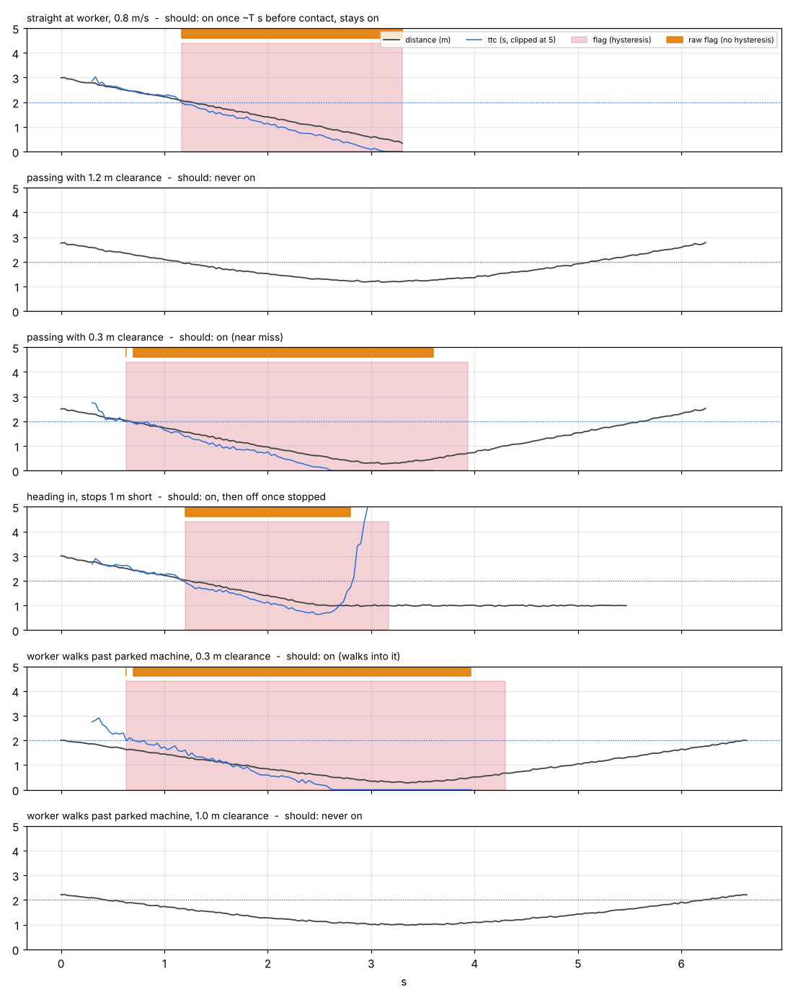

# Contact maths: is it really coming for them? (guide p.8)

A plain distance alarm fires whenever a machine is close, including when it is just
driving past. This asks a better question: *if nothing changes, how close will it get,
and how soon?*

## The geometry

```
                 machine  pm ●──────► vm
                            ╱ ·
                         p ╱   ·  path of the machine relative to the worker
                          ╱     ·   (relative velocity v = vm - vw)
                         ╱       ·
             worker pw  ●  ─ ─ ─ ─ ● closest approach: distance d_min at time t_cpa
                       (  R  )
                    contact circle
```

Work in the worker's frame: `p = pm − pw` and `v = vm − vw`. The gap after `t` seconds is

&nbsp;&nbsp;&nbsp;&nbsp;`gap(t) = |p + v·t|`

| Quantity | Formula | Meaning |
|---|---|---|
| `d` | `|p|` | distance now |
| `bearing` | `atan2(p_y, p_x)` | direction worker → machine, floor frame. Jordan compares it with head yaw. |
| `t_cpa` | `−(p·v)/(v·v)` | when the gap is smallest (negative = already past) |
| `d_min` | `|p + v·max(t_cpa, 0)|` | how small it gets |
| `ttc` | smallest `t > 0` with `|p + v t| = R` | solve `(v·v)t² + 2(p·v)t + (p·p − R²) = 0`; take the earlier root. `None` if it never gets that close, `0` if already inside `R`. |
| `approaching` | `ttc < T` | the flag Jordan's alert rule uses |

If the relative speed is below 5 cm/s the machine counts as stopped: `approaching` is
just `d < R`.

## Why hysteresis

Velocities come from noisy positions (±2 cm at 30 fps). A 2-frame difference gives
~0.5 m/s of velocity noise; a 0.5 s least-squares window gives ~0.02 m/s. Even then,
`ttc` hovers around `T` and the raw flag flickers. So the flag turns **on** as soon as
`ttc < T`, and turns **off** only after `ttc > T + 0.5 s` (or `None`) for 0.3 s.

## Simulator results (10 noise seeds each, R = 0.5 m, T = 2 s)

`python scripts/simulate_contact.py --plot out/contact.png`

| Scene | Should | Fired | Flag changes, raw | Flag changes, with hysteresis |
|---|---|---|---|---|
| Straight at worker, 0.8 m/s | on ~T s before contact, stays on | 10/10 | 2.6 | 1.0 |
| Passing, 1.2 m clearance | never | 0/10 | 0 | 0 |
| Passing, 0.3 m clearance | on (near miss) | 10/10 | 3.2 | 2.0 |
| Heading in, stops 1 m short | on, then off once stopped | 10/10 | 3.0 | 2.0 |
| Worker walks past parked machine, 0.3 m | on | 10/10 | 4.2 | 2.0 |
| Worker walks past parked machine, 1.0 m | never | 0/10 | 0 | 0 |

"Straight at worker" turns on 1.96 s before contact (target: ~T = 2 s).



## Tuning R and T for the toy

A real forklift does 2–4 m/s; our RC car does maybe 0.5–1 m/s on a 3 × 2 m floor.
T = 3 s at 1 m/s covers the whole rig and would fire constantly. Start at **T = 2 s,
R = 0.5 m**; retune with `--R`/`--T` on recorded runs. In the pitch, say the thresholds
scale with machine speed.

> ⏳ **Waiting for Zoe's clips C and D.** `ContactTracker.update(t, pw, pm, vm, vw)`
> takes her positions/velocities directly; run it per camera frame and compare the
> flag with what actually happened in the clip.
